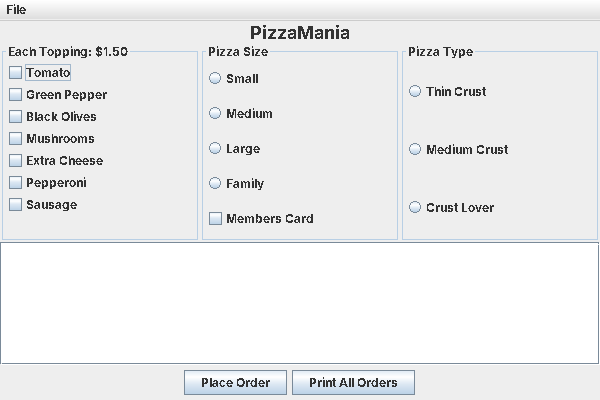

# Java Design Patterns: Sandwich Shop (Decorator) and Pizza Shop (Factory)

Two desktop ordering apps that put classic object-oriented design patterns into practice.

| Project | UI | Pattern |
|---|---|---|
| [`pizza-shop-factory`](pizza-shop-factory) | Java Swing | **Factory**: `PizzaFactory` builds the `Pizza` object |
| [`sandwich-shop-decorator`](sandwich-shop-decorator) | JavaFX | **Decorator**: sandwich add-ons wrap a base sandwich |

## Pizza Shop — Factory pattern



Customers choose a size, a crust and any number of toppings, and can apply a member card. Clicking **Place Order** asks `PizzaFactory` to create the pizza, so the UI never builds pizza objects directly.

- `Pizza` is an abstract base class, and `PizzaSize` is the concrete pizza that works out its price
- `CrustType` and `Topping` model the pricing options
- The member discount is tiered by size: 2% small, 5% medium, 7% large, 10% family
- **Print All Orders** lists every order placed in the session
- A **File** menu clears the form or exits

## Sandwich Shop — Decorator pattern

A JavaFX ordering screen for choosing a bread size and type, a sandwich, vegetables, sauces and extras, with a live price and order summary.

The project includes a Decorator implementation:

```
SandwichComponent (interface: getCost, getDescription)
├── BaseSandwich
└── SandwichDecorator (abstract, wraps a SandwichComponent)
    ├── BreadType
    ├── Vegetables
    ├── SauceDecorator
    └── Extras
```

Each decorator adds its own cost and description to the sandwich it wraps, so add-ons can be stacked in any order without a new subclass for every combination.

**Next step:** the GUI currently works out the price itself. Routing it through the decorator classes would put the pattern to work end to end.

## Running

You need **JDK 17** or later and **Maven**, or IntelliJ IDEA, which includes Maven. From either project folder:

```bash
mvn javafx:run
```
